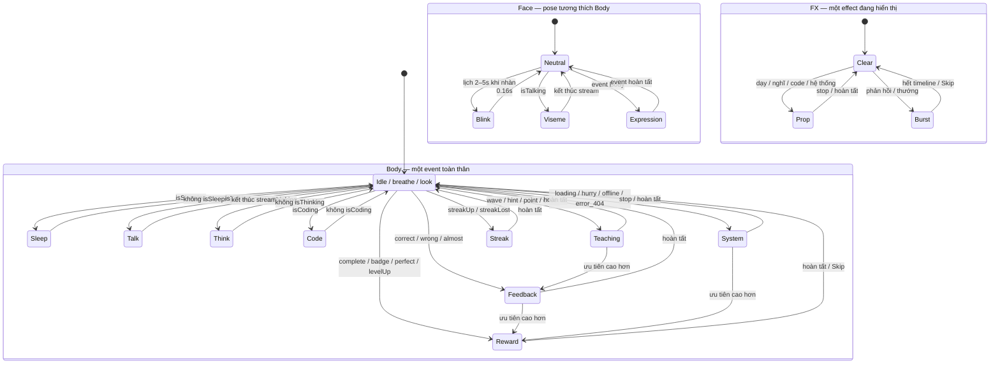

# Bitty — thiết kế nhân vật, chuyển động và tích hợp BytePath

Đặc tả triển khai ngày 14/10/2026. BytePath giữ **React, TypeScript, Vite và Motion** theo lựa chọn đã xác nhận; không chuyển framework. Bitty là mascot mặc định mới, các skin đã có được giữ lại. Binary thật `public/mascots/bitty/bitty.riv` đã được dựng bằng **Rive CLI 1.5.1**, **100.022 byte**, dưới giới hạn **200.000 byte**. File native chứa vector/keyframe/state machine, không có script/font/bitmap/tài nguyên mạng và không cần upload hoặc account trả phí. SVG là phương án dự phòng khi runtime tải lỗi. Tài liệu này vẫn phân biệt đặc tả nghệ thuật với kết quả kiểm thử; xem báo cáo phát hành để biết kết quả browser/mobile và hiệu năng thực tế.

Luận điểm hình ảnh: một mèo robot bạc hà tròn, mắt rất biểu cảm và ăng-ten nghiêng tạo cá tính. Nội dung trên màn hình giữ một việc chính; Bitty đứng cạnh ví dụ hoặc phản hồi, không che bài tập. Chuyển động có ba nhịp: chuẩn bị ngắn → hành động rõ → tai và ăng-ten theo sau; phần thưởng lớn xuất hiện sau xác nhận của backend.

## 1. Concept, bảng màu và SVG

**Bitty** là mèo robot nhỏ hơi vụng, thích biến chuyện debug thành trò vui. Một chiếc răng cửa, tai không đối xứng hoàn toàn và ăng-ten lệch nhẹ giúp nhận diện từ hình bóng. Không sử dụng cú, hình dáng, âm thanh hoặc asset Duolingo. Hai tên dự phòng cho lần đổi thương hiệu là **MochiBit** và **Pip**, chưa dùng trong sản phẩm.

Câu cửa miệng: “Một bug nữa, một bài học nữa!”, “Compile niềm vui thành công!”, “Gần đúng rồi, mình đổi một dòng nhé.” Khi người học nghỉ lâu: “RAM của tớ nhớ cậu rồi.” Khi sai: “Tớ vừa trượt một nhịp. Mình thử lại nhé.” Tránh mỉa mai năng lực, thúc ép streak hoặc thông báo gây tội lỗi.

| Sắc thái | Mắt/miệng | Tai, tay và ăng-ten | Ý nghĩa |
|---|---|---|---|
| Vui | Mắt tròn hoặc sao, cười lộ răng | Tai mở, tay cao, đầu ăng-ten xanh | Ghi nhận điều đã làm được |
| Tập trung | Mắt theo nội dung, miệng nhỏ | Tay chỉ, nghiêng đầu, đầu ăng-ten vàng | Hướng sự chú ý vào kiến thức |
| Ngạc nhiên | Mắt lớn, miệng O | Tai dựng, ăng-ten trễ nửa nhịp | Một ý tưởng hoặc quà mới |
| Drama nhẹ | Mắt híp, miệng buồn rồi cười | Tay ôm đầu, ăng-ten coral | Sai là một bước học, kết thúc bằng động viên |
| Nghỉ | Mắt khép, miệng nhỏ | Tai hạ, đầu ăng-ten màu mực | Đang chờ hoặc nghỉ; không phải hình phạt |

| Vai trò | HEX | Quy tắc |
|---|---|---|
| Thân bạc hà | `#76DEC1` | Mảng lớn ở thân và đầu |
| Khớp/tai/đuôi | `#3AA58E` | Tách hình khối; trạng thái vui của ăng-ten |
| Mực | `#243E4B` | Mắt, miệng, nét; trạng thái nghỉ/buồn của ăng-ten |
| Kem | `#FFF9E9` | Mặt, bụng, răng và highlight |
| Vàng | `#F3CB65` | Bóng đèn, thưởng, trạng thái suy nghĩ |
| Nhấn coral | `#F4887E` | Má, lưỡi và trạng thái drama; dùng ít |

Đây là năm màu chính và một màu nhấn. Nền mascot trong suốt; ở giao diện tối, vùng kem và nét mực vẫn giữ hình nhận diện. Màu cảm xúc luôn kèm mắt/miệng và câu mô tả, không truyền tải đúng/sai chỉ bằng màu. Đầu ăng-ten sáng bằng một vòng vector có opacity thấp, không dùng blur.

Asset gốc: [bitty-rig.svg](../public/mascots/bitty/bitty-rig.svg), bản vẽ `256 × 256`. Artboard runtime Rive là **360 × 360**, thêm vùng transparent **52px mỗi bên** để nhảy/xoay không cắt tai hoặc ăng-ten. SVG fallback dùng cùng vùng nhìn `-52 -52 360 360`. Các group có ID cố định:

```text
shadow, tail, leg_L, leg_R, body, belly, arm_L, arm_R,
ear_L, ear_R, antenna_stem, antenna_tip, head,
eye_L, eye_R, pupil_L, pupil_R, eyelid_L, eyelid_R,
eyebrow_L, eyebrow_R, cheek_L, cheek_R,
mouth_closed, mouth_open_A, mouth_open_E, mouth_open_O,
mouth_smile, mouth_sad, mouth_wow, tongue
```

`head` là hình đầu; các layer mặt đứng riêng để rig, không merge mắt vào đầu. Group miệng chỉ hiện một hình tại một thời điểm, `tongue` có điều kiện đi kèm. Giữ `shadow` nằm ngoài root của nhân vật để bóng không bay theo khi nhảy. Xem thêm [concept và hướng dẫn pivot](BITTY-CONCEPT.md).

Props riêng nằm ở `public/mascots/bitty/props/`: `whiteboard.svg`, `laptop.svg`, `bulb.svg`, `trophy.svg`, `level-badge.svg`, `streak-fire.svg`, `confetti.svg`, `star.svg`, `heart.svg`, `coffee.svg`, `question.svg`, `exclamation.svg`. Dùng một bản prop trong artboard rồi bật/tắt; không nhân bản mascot cho từng timeline.

## 2. Bảng toàn bộ 27 animation

Thời lượng sau đây đồng bộ với `shared/mascot-motion.mjs`; tất cả timeline thiết kế ở **60 FPS**. FPS là đơn vị timeline, không phải cam kết thiết bị luôn đạt 60 FPS. `Lặp` là chu kỳ có thể dừng bằng controller; mọi one-shot có thể bỏ qua.

| ID | Timeline | Lặp? | Giây | Trigger/API | Mô tả |
|---:|---|---|---:|---|---|
| 01 | `idle_breathe` | Có | 2,80 | trạng thái nền | Thở 2–3%, tai và ăng-ten trễ nhịp |
| 02 | `idle_blink` | Không | 0,16 | `say('idle_blink')` | Chớp mắt; lịch ngẫu nhiên cách nhau 2–5 giây |
| 03 | `idle_look` | Có | 1,80 | `lookAt({x,y})` | Nhìn theo mục tiêu; không kéo cả đầu theo mỗi pixel |
| 04 | `idle_bored` | Không | 2,60 | sau 10 giây phù hợp | Ngáp, gãi đầu và gõ chân |
| 05 | `idle_sleep` | Có | 3,00 | `isSleeping` | Ngủ gật, bong bóng và Zzz nhẹ |
| 06 | `wave_hello` | Không | 1,10 | `wave` | Nhảy nhỏ rồi vẫy tay |
| 07 | `teach_talk` | Có | 1,80 | `isTalking`, `talk()` | Miệng theo viseme, đầu gật và tay giải thích |
| 08 | `teach_point` | Không | 1,50 | tên timeline | Chỉ trái/phải về nội dung |
| 09 | `teach_think` | Có | 2,40 | `isThinking` | Chống cằm, mắt lên cao, dấu hỏi |
| 10 | `teach_idea` | Không | 1,70 | `hint` | Bóng đèn bật, mắt sáng và tay búng |
| 11 | `teach_code` | Có | 2,00 | `isCoding` | Gõ laptop, mắt đọc các dòng code |
| 12 | `answer_correct` | Không | 1,00 | `correct` | Nhảy, mắt sao, tay giơ cao |
| 13 | `answer_correct_combo` | Không | 1,40 | `correct`, combo 3/5/10 | Nảy mạnh hơn và thêm ngọn lửa nhỏ |
| 14 | `answer_wrong` | Không | 1,80 | `wrong` | Ngồi phịch, ôm đầu rồi đứng dậy |
| 15 | `answer_almost` | Không | 1,00 | `almost` | Nghiêng đầu, nháy mắt động viên |
| 16 | `timer_hurry` | Có | 1,80 | `hurry` | Hơi căng thẳng và một giọt mồ hôi |
| 17 | `lesson_complete` | Không | 2,80 | `complete` | Confetti, cúp, tổng XP đã xác nhận |
| 18 | `perfect_score` | Không | 3,60 | `perfect` | Xoay vui, mắt tim và sao nở |
| 19 | `streak_up` | Không | 2,20 | `streakUp` | Lửa streak và số ngày mới |
| 20 | `streak_lost` | Không | 2,40 | `streakLost` | Lửa nhỏ lại, cuối cùng ngẩng đầu |
| 21 | `level_up` | Không | 4,60 | `levelUp` | Bay lên, huy hiệu flip, tia sáng và cấp mới |
| 22 | `badge_unlock` | Không | 2,30 | `badge` | Quà mở, huy hiệu bật lên, sparkle |
| 23 | `xp_gain` | Không | 0,90 | tên timeline | Hạt XP bay về thanh tiến độ |
| 24 | `cheer_encourage` | Không | 1,80 | `cheer` | Nắm tay nhỏ, gật đầu, khích lệ |
| 25 | `loading` | Có | 1,40 | `loading`; `stop(id)` | Bước chân tại chỗ và xoay ăng-ten |
| 26 | `error_404` | Không | 2,30 | tên timeline | Nhìn hai đầu cáp bị đứt |
| 27 | `offline` | Có | 2,20 | tên timeline; `stop(id)` | Cầm dây mạng, chờ kết nối |

`timer_hurry` chỉ dùng khi người học chủ động chọn hoạt động luyện có giờ; bài kiểm tra hiện có không bị áp đặt thời gian. `idle_bored` không xuất hiện khi đang đọc dài, viết code, thi, focus editor hoặc tab ẩn. Không biến 10 giây không có click thành “bỏ học”.

## 3. Keyframe chi tiết

Đơn vị vị trí là pixel trên artboard 256; scale `1` và góc `0°` là pose gốc. Khi thu/phóng component, cùng một rig được scale đồng đều. `root` là group mới chứa nhân vật, trừ bóng. Nhịp tai/ăng-ten thường trễ `0,06–0,10s`, không phải một timer độc lập cho mỗi bộ phận.

Easing chung: **cubic-out** `(0.22,1,0.36,1)` cho hạ cánh và xuất hiện; **cubic-in-out** `(0.65,0,0.35,1)` cho thở và dịch cảnh; **back-out** `(0.34,1.56,0.64,1)` cho quà; **linear** cho tiến độ và mouth selection; **elastic-soft** chỉ dùng 1–2 lần overshoot scale nhẹ, không lắc vô hạn. Keyframe có cùng điểm đầu/cuối để loop không giật. SFX là gợi ý thiết kế: mặc định tắt, chỉ phát sau tương tác và không tự tải audio ngoài.

### 01 — `idle_breathe`

60 FPS, loop 2,80s. `0.00`: root `(sx=1,sy=1)`; `0.70`: `(0.988,1.018)`, thân lên `-1`; `1.40`: `(1.015,0.985)`; `2.10`: `(0.994,1.010)`; `2.80`: về gốc. Cực trị không vượt 3%. Tai `±2°`, ăng-ten `±3°` theo sau 0,08s; bóng thay scaleX `0.98→1.02`.

Layer: root/body/belly/head/ear_L/ear_R/antenna_stem/antenna_tip/shadow. Easing cubic-in-out. SFX: im lặng. Neo root tại chân, không scale riêng head lần thứ hai.

### 02 — `idle_blink`

60 FPS, one-shot 0,16s. `0.00`: mắt mở; `0.05`: pupil scaleY `0.12`, eyelid hiện; `0.09`: nhắm hoàn toàn; `0.16`: mở lại. Chớp đôi chỉ thỉnh thoảng, không áp lịch đều mỗi 2 giây.

Layer: eye_L/eye_R/pupil_L/pupil_R/eyelid_L/eyelid_R. Easing cubic-out đóng/mở, opacity stepped. SFX: im lặng. Lịch 2–5s do app quản lý, ngừng khi tab ẩn hoặc reduced motion; timeline không chứa khoảng chờ 5s.

### 03 — `idle_look`

60 FPS, loop nhàn 1,80s hoặc pose blend theo input. `0.00`: giữa; `0.45`: nhìn trái `x=-4,y=0`; `0.90`: nhìn lên `x=0,y=-3`; `1.35`: nhìn phải `x=4,y=0`; `1.80`: giữa. Khi có `lookX/lookY`, mục tiêu clamp `[-1,1]`, pupil dịch tối đa 4px/3px và đầu xoay tối đa 3°; blend 120ms.

Layer: pupils/head/eyebrows. Easing cubic-in-out. SFX: im lặng. Một listener pointer chung với update tối đa một lần mỗi animation frame; trên touch giữ nhìn giữa, không theo ngón tay trên toàn trang.

### 04 — `idle_bored`

60 FPS, one-shot 2,60s. `0.00`: vai xuống; `0.35`: đầu nghiêng `-7°`, miệng O mở; `0.85`: arm_R gãi tai `-32°`; `1.25`: chân trái lên/xuống 3px; `1.75`: khép miệng; `2.60`: đứng thẳng, cười. Ngáp ngắn, không lời trách.

Layer: head/mouth_open_O/eyelids/arm_R/leg_L/ears/antenna. Easing cubic-out, chân cubic-in-out. SFX: ngáp rất nhỏ tùy chọn. Một lần mỗi đợt nhàn đủ điều kiện, không loop nền khi đang học.

### 05 — `idle_sleep`

60 FPS, loop 3,00s. `0.00`: mắt khép; `0.75`: đầu hạ 6px/nghiêng 6°; `1.50`: bong bóng mũi scale `0.7→1`, Zzz lên 8px; `2.25`: đầu lên 2px; `3.00`: trở về. Tai thấp hơn gốc `6°`.

Layer: head/eyelids/mouth_closed/ears/antenna + props bubble/Zzz dựng bằng vector. Easing cubic-in-out. SFX: im lặng. `isSleeping=false` đưa về thở trong 180ms, không chờ hết vòng.

### 06 — `wave_hello`

60 FPS, one-shot 1,10s. `0.00`: squash `(1.05,0.95)`; `0.12`: root lên `-10`, stretch `(0.96,1.06)`; `0.28`: arm_R lên `-65°`; `0.42/0.56/0.70`: cổ tay qua lại `±12°`; `0.84`: hạ đất; `1.10`: về gốc. Tai/ăng-ten trễ 0,08s.

Layer: root/arm_R/ears/antenna/shadow/mouth_smile. Easing cubic-out cho hop, cubic-in-out cho tay. SFX: một “pop” nhỏ. Không chào lại sau mỗi thay đổi input hoặc render React.

### 07 — `teach_talk`

60 FPS, loop cử chỉ 1,80s. `0.00`: tay mở; `0.45`: head nghiêng `2°`; `0.90`: arm_L lên `-10°`; `1.35`: head gật 2px; `1.80`: về gốc. Miệng do viseme stream, không lấy loop để suy đoán âm thanh.

Viseme `0=closed`, `1=open_A`, `2=open_E`, `3=open_O`, `4=smile`, `5=wow`. Giá trị nguyên, step selection, chỉ một miệng hiện. Layer: mouth solo/tongue/head/arms/eyebrows. Easing mouth linear/step, gesture cubic-in-out. SFX: không có; voice nếu bổ sung phải được người dùng chủ động bật. Kết thúc stream trả viseme về 0.

### 08 — `teach_point`

60 FPS, one-shot 1,50s. `0.00`: root xoay 3° về nội dung; `0.20`: tay kéo về làm anticipation; `0.45`: tay duỗi hướng mục tiêu, mắt nhìn theo; `0.85`: giữ pose; `1.15`: tay thu; `1.50`: gốc. Variant trái/phải đổi tay chủ động và hướng nhìn, không mirror chữ trên bảng.

Layer: head/pupils/arm_L hoặc arm_R/whiteboard. Easing cubic-out. SFX: tùy chọn một click nhẹ ở 0,45s. Renderer nhận metadata trái/phải và ánh xạ sang Number Rive `pointDirection=-1/+1` đã có trong binary.

### 09 — `teach_think`

60 FPS, loop 2,40s. `0.00`: arm_R chống cằm; `0.40`: pupils lên `-3`; `0.80`: question hiện scale `0→1`; `1.30`: head nghiêng `-4°`; `1.80`: question lên 3px; `2.40`: pose đầu. Giữ miệng nhỏ, ăng-ten vàng.

Layer: arm_R/head/pupils/eyebrows/mouth_closed/antenna_tip/question. Easing cubic-in-out, prop cubic-out. SFX: im lặng. Bỏ thinking khi đã có phản hồi; không giả trạng thái xử lý của backend bằng animation.

### 10 — `teach_idea`

60 FPS, one-shot 1,70s. `0.00`: nhắm một phần mắt; `0.22`: bulb bật opacity/scale `0→1.08`; `0.45`: mắt mở lớn, tay mở; `0.75`: tia bulb nở một lần; `1.05`: bulb scale `1`; `1.70`: về cười. Không strobe.

Layer: bulb/arms/pupils/eyelids/antenna/head. Easing back-out nhẹ cho bulb, cubic-out cho thân. SFX: “ting” ở 0,22s. Dùng khi mở gợi ý luyện tập; không chạy trong lượt thi bị cấm trợ giúp.

### 11 — `teach_code`

60 FPS, loop 2,00s. `0.00`: laptop mở, mắt trái; `0.30`: tay trái xuống 2px; `0.65`: tay phải xuống 2px; `1.00`: mắt đọc sang phải; `1.45`: mắt trở về đầu dòng; `2.00`: gốc. Tay gõ xen kẽ, không flash màn hình laptop.

Layer: laptop/arms/pupils/head/mouth_closed. Easing cubic-in-out. SFX: im lặng mặc định; bàn phím cực nhẹ nếu bật. Chỉ một nhịp gesture, code runner thật vẫn là nguồn trạng thái.

### 12 — `answer_correct`

60 FPS, one-shot 1,00s. `0.00`: squash `(1.08,0.90)`; `0.12`: rời đất, stretch `(0.92,1.12)`; `0.35`: đỉnh `y=-24`, tay cao và mắt sao; `0.60`: hạ; `0.75`: squash hạ cánh `(1.07,0.94)`; `1.00`: gốc, cười. Đầu ăng-ten xanh.

Layer: root/arms/pupils (solo sao)/ears/antenna/shadow/star. Easing cubic-out khi đáp, cubic-in khi rơi. SFX: “pop + ting” đơn. Chỉ phát khi checker xác nhận đúng; một ID câu trả lời không phát hai lần.

### 13 — `answer_correct_combo`

60 FPS, one-shot 1,40s. `0.00`: crouch; `0.15`: lên `-28/-34/-40px` cho combo 3/5/10; `0.40`: sao nở, lửa nhỏ sau thân; `0.70`: hạ; `0.90`: nảy phụ tối đa 8px; `1.20`: lửa nhỏ lại; `1.40`: gốc. Combo lớn tăng biên độ có giới hạn, không tăng độ chói hay số lần flash.

Layer: như correct + streak-fire. Easing cubic-out/back-out nhẹ. SFX: ba cao độ tùy combo, không stack ba âm. Controller chỉ dùng biến thể đúng ở mốc 3, 5, 10, reset khi sai.

### 14 — `answer_wrong`

60 FPS, one-shot 1,80s. `0.00`: wow, ăng-ten coral; `0.20`: đầu lùi 4px; `0.45`: ngồi phịch `y=10`, squash `1.06/0.94`; `0.75`: hai tay ôm đầu; `1.10`: nhìn người học; `1.45`: đứng lên, tay mở; `1.80`: cười nhỏ. Không đổ người 90°, không làm nhục hay rung cả trang.

Layer: root/arms/head/ears/mouth_wow→sad→smile/antenna_tip/shadow. Easing cubic-out; recover back-out tối đa 1,03. SFX: “boop” trầm nhẹ, không còi fail. Văn bản kèm nguyên nhân sai và bước thử tiếp theo.

### 15 — `answer_almost`

60 FPS, one-shot 1,00s. `0.00`: đầu giữa; `0.22`: nghiêng `6°`; `0.40`: nháy mắt phải; `0.65`: tay đưa về nội dung; `1.00`: gốc. Ăng-ten vàng, cười động viên.

Layer: head/eyelid_R/arm_R/antenna. Easing cubic-out. SFX: im lặng hoặc chime mềm. “Gần đúng” dựa trên phản hồi checker được phép, không suy đoán điểm hoặc tự cộng XP.

### 16 — `timer_hurry`

60 FPS, loop 1,80s. `0.00`: nhìn đồng hồ; `0.35`: giọt mồ hôi xuất hiện; `0.65`: root x `-2`; `0.95`: x `2`; `1.25`: x `0`; `1.80`: pose đầu. Một rung trái/phải trong 1,8s, không rung liên tục tần số cao.

Layer: root/pupils/eyebrows/antenna/exclamation/sweat vector. Easing cubic-in-out. SFX: không tick liên tục. Chỉ phiên luyện có giờ được tự nguyện bật; tắt timer thì dừng ngay, giữ câu trả lời.

### 17 — `lesson_complete`

60 FPS, one-shot 2,80s. `0.00`: chuẩn bị nhảy; `0.20`: root lên `-24`; `0.55`: confetti tối đa 24 mảnh nở; `0.90`: cúp scale `0→1.08`; `1.20`: cúp về 1, số XP bắt đầu tăng; `2.00`: mascot đáp; `2.80`: trạng thái cuối, cúp/XP vẫn đọc được. Nút tiếp tục có sẵn trong suốt hiệu ứng.

Layer: root/trophy/confetti/star/ears/antenna. Easing cubic-out, cúp back-out, XP cubic-out. SFX: fanfare khoảng 0,7s. Giá trị XP hiển thị lấy report/ledger backend; số chữ hiển thị HTML để không nhúng font vào file Rive.

### 18 — `perfect_score`

60 FPS, one-shot 3,60s, ngoại lệ cho giới hạn 3s. `0.00`: anticipation; `0.30`: nhảy; `0.80`: xoay tổng một vòng qua 3 pose, không quay cả chữ; `1.35`: mắt tim; `1.80`: hai chùm sao nở, không flash trắng; `2.50`: hạ cánh; `3.60`: cười và kết quả tĩnh. Không phát lesson_complete đồng thời.

Layer: root/heart/star/confetti/arms/shadow. Easing cubic-out, xoay cubic-in-out. SFX: fanfare tối đa 1s. Chỉ điểm chính thức 100%, không “perfect” nếu code còn pending hoặc lỗi hệ thống.

### 19 — `streak_up`

60 FPS, one-shot 2,20s. `0.00`: flame nhỏ; `0.35`: tay nâng đuốc; `0.75`: flame scale `1.15`, số ngày mới xuất hiện; `1.25`: tai bật một lần; `1.70`: lửa về scale 1; `2.20`: pose cuối. Không làm lửa phủ nội dung.

Layer: arms/streak-fire/head/ears/antenna. Easing back-out cho lửa, cubic-out cho số HTML. SFX: whoosh nhỏ + một bell. Ngày/streak do backend Asia/Saigon xác nhận, không tự tăng qua animation.

### 20 — `streak_lost`

60 FPS, one-shot 2,40s. `0.00`: lửa thu nhỏ; `0.35`: head hạ 6px, tai thấp; `0.80`: mouth_sad; `1.25`: mắt nhìn lên; `1.70`: tay mở, miệng cười; `2.40`: pose trung lập. Kết thúc: “Bắt đầu lại từ hôm nay nhé.”

Layer: streak-fire/head/ears/mouth/arms/antenna. Easing cubic-in-out. SFX: im lặng. Không lặp, không thông báo rằng người học “mất tất cả”; bảo vệ streak vẫn theo backend.

### 21 — `level_up`

60 FPS, one-shot 4,60s, ngoại lệ cho giới hạn 3s. `0.00`: XP đã có trên report, thanh bắt đầu điền; `0.70`: thanh đầy, root chuẩn bị; `1.05`: root lên `-36`; `1.60`: badge flip `scaleX=1→0→1` với hai mặt tĩnh; `2.15`: tia sáng sau mascot mở, cấp mới xuất hiện; `2.50`: rung riêng khung ±2px một lần; `3.10`: quà hiện; `4.60`: quà/cấp giữ tĩnh. Người học có thể bỏ qua từ đầu.

Layer: root/level-badge/star/rays/arms/shadow. Easing cubic-out và back-out nhẹ; tia xoay tối đa 30°, không vortex vô hạn. SFX: whoosh + chime khoảng 1s. Nếu vượt nhiều cấp, một chuỗi hiển thị cấp đầu→cuối và toàn bộ quà đã nhận; không cộng lại bằng callback.

### 22 — `badge_unlock`

60 FPS, one-shot 2,30s. `0.00`: hộp/quà scale 0,96; `0.30`: anticipation xuống 3px; `0.65`: nắp mở; `1.00`: badge lên `-18px`, scale 1,10; `1.45`: sparkle nở một lần; `1.90`: badge về 1; `2.30`: pose cuối.

Layer: level-badge/gift nhóm vector/star/root/arms. Easing back-out cho badge, cubic-out cho nắp. SFX: pop + chime. Gift đã nhận được giữ trong backend, mở lại modal không nhận lần nữa.

### 23 — `xp_gain`

60 FPS, one-shot 0,90s. `0.00`: 3–5 hạt XP ở nguồn; `0.12`: hạt xuất hiện; `0.40`: qua điểm điều khiển cung cong; `0.72`: đến thanh; `0.90`: opacity 0 và thanh giữ giá trị cuối. Không tạo một DOM node cho mỗi XP.

Layer: star/XP vector; thanh/số trong HTML. Easing cubic-out; một quỹ đạo transform không layout mỗi frame. SFX: một “plink” ở đích. Với XP vượt 999, input Rive dùng clamp, số HTML hiển thị đầy đủ giá trị thực.

### 24 — `cheer_encourage`

60 FPS, one-shot 1,80s. `0.00`: nhìn người học; `0.30`: nắm tay lên; `0.65`: gật đầu; `1.00`: tay còn lại chỉ bước cần làm; `1.35`: miệng cười; `1.80`: gốc. Cử chỉ vừa phải.

Layer: arms/head/eyebrows/mouth/antenna. Easing cubic-out. SFX: im lặng hoặc hai note mềm. Có thể dùng sau nhiều lỗi khác nhau, không chỉ dựa vào số fail; đề xuất ôn kiến thức cụ thể.

### 25 — `loading`

60 FPS, loop 1,40s. `0.00`: chân trái lên 3px; `0.35`: chân đổi; `0.70`: ăng-ten quay 10°; `1.05`: ăng-ten về -5°; `1.40`: gốc. Thân nảy 2px, không chạy vòng cả màn hình khi đọc trạng thái.

Layer: legs/root/antenna/ears. Easing cubic-in-out. SFX: im lặng. `say('loading',{id})` và `stop(id)` gắn với request thực; không bịa tỷ lệ tiến độ, không thêm thời gian chờ để khoe animation.

### 26 — `error_404`

60 FPS, one-shot 2,30s. `0.00`: cầm cáp; `0.40`: nhìn đầu trái; `0.85`: nhìn đầu phải; `1.25`: question hiện; `1.70`: nhún vai; `2.30`: nhìn người học. Cáp dựng vector, không có image runtime ngoài.

Layer: arms/pupils/head/question/cable metadata. Easing cubic-in-out. SFX: im lặng. Nội dung HTML có “Trang không tồn tại” và nút về hành trình; mascot không là cách duy nhất hiểu lỗi.

### 27 — `offline`

60 FPS, loop 2,20s. `0.00`: nhìn đầu dây; `0.55`: head nghiêng `4°`; `1.10`: question lên 3px; `1.65`: đầu nhìn về người học; `2.20`: pose đầu. Không làm mặt buồn vô hạn hoặc ép tải lại mất bản nháp.

Layer: head/pupils/arms/antenna/question/cable. Easing cubic-in-out. SFX: im lặng. App phải nói rõ chưa kết nối backend hay Internet; chấm local có thể tiếp tục khi chỉ mất Internet. Dừng bằng `stop(id)` khi điều kiện lỗi được giải quyết.

## 4. Sáu kiểu chuyển cảnh

Component thật: [PageTransition.tsx](../src/bitty/PageTransition.tsx) và [page-transition.css](../src/bitty/page-transition.css). Mỗi lần chuyển dùng `transitionKey` là pathname hoặc activity ID; không dùng timestamp theo mỗi render. Nội dung mới được render ngay, decoration không chặn click và không giữ focus. Không giữ trang cũ trong một exit queue.

| Variant | Giây | Easing | Thứ tự layer và động tác | Tình huống |
|---|---:|---|---|---|
| `mascot_wipe` | 0,62 | cubic-in-out | Nội dung mới z1, màn che vector z2, Bitty ở đầu màn che; đi ngang, reveal inset | Bắt đầu chặng hoặc khóa |
| `iris_circle` | 0,55 | cubic-out | Nội dung mới reveal circle từ `origin` vị trí mascot (mặc định 50%/35%) | Mở bài mới |
| `jump_through` | 0,64 | cubic-out | Nền bạc hà fade nhẹ, nội dung lên 18px; Bitty ở z2 nhảy lên rồi biến mất | Đổi hoạt động khám phá |
| `slide_card` | 0,42 | cubic-out | Nội dung mới trượt 30px theo direction và fade; mascot trong nội dung nhìn theo | Trước/sau câu hỏi |
| `curtain_pixel` | 0,66 | cubic-out | 12 dải pixel z2 thu về mép, delay 18ms/dải, nội dung z1 | Vào phòng code |
| `celebration_fade` | 0,50 | cubic-out | Nền kem/xanh z2 fade, kết quả z1 xuất hiện nhẹ | Ăn mừng → tổng kết |

“Tiếp tục” đổi route/activity bằng luồng bình thường của ứng dụng, sau đó wrapper chạy entry. Bấm liên tiếp: chỉ key cuối tồn tại, animation trước unmount và callback cũ không thông báo hoàn tất route mới. Không khóa mọi nút 0,8s. API mutations vẫn cần nút pending và idempotency của backend, độc lập với chuyển cảnh.

Sau reveal, `clip-path` tạm được bỏ để menu, tooltip và focus outline không bị cắt. Reduced motion: tất cả variant thành fade nhẹ 0,12s, không mascot chạy, vòng iris, pixel, rung hoặc chuyển vị trí. DOM route mới vẫn hiện ngay; route focus nên được quản lý riêng bằng heading có `tabIndex=-1`, không focus vào decoration.

## 5. State machine `MascotSM`

Rive state machine điều khiển pose/layer; **provider React điều phối ưu tiên, queue và ID**. Chấm điểm, XP, mua đồ, streak và cấp vẫn do backend, tuyệt đối không dùng event trong Rive để cấp thưởng. State machine, states và layers được mô tả trong [tài liệu chính thức](https://rive.app/docs/editor/state-machine/state-machine).

### Hợp đồng input

| Loại | Tên | Giá trị/ý nghĩa |
|---|---|---|
| Trigger | `wave`, `correct`, `wrong`, `almost`, `complete`, `perfect`, `levelUp`, `streakUp`, `streakLost`, `badge`, `hint`, `hurry`, `cheer`, `loading` | Một event đã được provider cho phép phát |
| Boolean | `isTalking`, `isThinking`, `isSleeping`, `isCoding` | Pose nền; tắt khi kết thúc hoạt động |
| Number | `viseme` | Số nguyên 0–5, chọn miệng |
| Number | `combo` | Số nguyên 0–10; correct có biến thể ở 3/5/10 |
| Number | `lookX`, `lookY` | -1…1, mục tiêu mắt |
| Number | `xp` | Số nguyên 0–999 dành cho FX; giá trị thật nằm trong HTML |
| Number | `mood` | 0 trung lập, 1 vui, 2 nghĩ, 3 buồn, 4 drama |

Binary thêm ba control có trong [contract](../animation/bitty/contract.json): Trigger **`play`**, Number **`stateIndex` 0–26** theo thứ tự 27 timeline, và Number **`pointDirection` -1/+1**. Adapter gửi `stateIndex` rồi fire `play` để các timeline không có trigger riêng cũng hoạt động. Vì vậy binary có tổng **15 trigger, 4 Boolean, 8 Number**; 14 trigger/4 Boolean/6 Number phía trên vẫn giữ đầy đủ yêu cầu. Level, streakDays và prop vẫn là metadata/UI. Loading/offline loop kết thúc bằng `stop(id)`; snapshot kế tiếp chọn idle. Không tự giả định có Boolean `isLoading`/`isOffline`.

### Layers và quyền sở hữu thuộc tính

1. **Body**: root transform, tay/chân, head pose, tai/ăng-ten; trạng thái nền và one-shot chiếm cùng một lane.
2. **Face**: miệng solo/viseme, pupils/look, eyelids/blink, eyebrows. Tạm ngừng blink/look tự động khi correct/perfect yêu cầu mắt sao/tim.
3. **FX**: prop, confetti tối đa 24 mảnh, rays, glow vector. Mỗi FX reset opacity/scale về giá trị gốc khi rời state.

File native cụ thể có **11 layer**: ba layer chính trên và tám layer điều khiển độc lập **LookX, LookY, Combo, Point, XP, Mood, ThinkLook, CodeEyes**. Có **27 timeline bắt buộc + 61 helper = 88 timeline**; helper là pose/blend phục vụ điều khiển, không phải 61 hoạt động mới. Các layer phân chia thuộc tính để gaze, mouth và trạng thái chính không ghi đè lẫn nhau.

Một state machine layer chạy một state tại một thời điểm. Thứ tự layer trong Rive có thể quyết định layer thắng khi cùng key một thuộc tính; vì vậy không để Body và Face cùng key pupil transform, hoặc hai state cùng điều khiển root. [Quy tắc layer của Rive](https://rive.app/docs/editor/state-machine/layers).

### Chuyển trạng thái, blend và ngắt

| Nhóm | State/timeline | Điều kiện | Blend | Có thể bị ngắt? |
|---|---|---|---:|---|
| Nền | breathe/look/sleep | Boolean hoặc không có event | 120–180ms | Có, bởi event bất kỳ |
| Nhàn ngắn | blink/bored | Scheduler đã cho phép | 40/120ms | Có |
| Dạy | talk/think/code/point | Boolean/stream/timeline | 120ms | Có, bởi phản hồi/thưởng |
| Hint/chào | idea/wave/cheer | Trigger tương ứng | 120ms | Có, event ưu tiên cao hơn |
| Trả lời | correct/combo/wrong/almost/XP | Checker/ledger tương ứng | 120ms | Có, ưu tiên cao hơn |
| Streak/hệ thống | hurry/streakUp/streakLost/404/offline | Trạng thái thực | 120ms | Có, ưu tiên cao hơn |
| Thưởng | complete/badge/perfect/levelUp | Reward ID đã xác nhận | 120ms | Không tự ngắt bởi event mới; có Skip/cancel |
| One-shot → nền | mọi one-shot đã xong | Timeline đã kết thúc hoặc controller skip | 120ms | Chọn nền theo Boolean hiện tại |
| Loop → nền | loading/offline | `stop(id)` từ owner request | 120ms | Dừng khi trạng thái thực đổi |

Priority trong controller: level 100; perfect 95; complete/badge 85; streakUp 80; streakLost/404 75; hurry/offline 70; wrong 65; correct/combo 60; XP55; almost50; cheer45; hint40; wave30; point25; talk/think/code20; loading10; blink/bored5; idle0. Event mới chỉ cắt event đang chơi nếu ưu tiên cao hơn **và** event đang chơi cho phép ngắt. Cùng ưu tiên đi theo thứ tự enqueue. Queue tối đa tám event, giữ event quan trọng hơn khi tràn; callback nhận lý do thay vì âm thầm mất event. Không có hai one-shot cùng chạy toàn thân.



Đây là sơ đồ hành vi thiết kế. Không dùng `Any State` cho mọi trigger rồi mong thứ tự transition thay thế queue ưu tiên: provider quyết định event trước khi gửi input. Khi reduced motion bật giữa animation, chuyển ngay về pose cuối tĩnh; callback hoàn tất tối đa một lần, không phát âm hoặc phần thưởng lần nữa.

## 6. Dựng trong Rive Editor và xuất file

Hướng dẫn thao tác và CLI được tách chi tiết trong [BITTY-RIVE.md](BITTY-RIVE.md). Bản tóm tắt đủ để mở đúng rig:

1. Tạo file Bitty, artboard `Bitty` 360×360, nền trong suốt; import bản vẽ 256×256 và đặt lệch 52px mỗi bên, cùng 12 props. Kiểm tra hierarchy còn tên layer. Rive chuyển SVG thành vector có thể sửa, không load SVG gốc ở runtime. [SVG import](https://rive.app/docs/editor/assets/svg).
2. Tạo root và xương/pivot chân, cổ, vai, tai, gốc ăng-ten và đuôi; parent vector vào xương. Root không chứa shadow. Dùng biến dạng path chỉ khi cần, không mesh ảnh. [Bones](https://rive.app/docs/editor/manipulating-shapes/bones).
3. Tạo solo miệng và mắt variant, giữ shape gốc là neutral; thêm animation theo 27 tên và thời lượng trên. Key start/end rõ ràng, loop nối kín.
4. Tạo `MascotSM`, input đúng casing, ba nhóm Body/Face/FX và các layer control có ownership rõ; thêm transitions/blends, thử trigger độc lập rồi thử combo và Skip. Binary hiện hành dùng 11 layer theo contract.
5. XP/cấp/streak/CTA nằm trong HTML để dễ đọc, hỗ trợ tiếng Việt và không nhúng font vào `.riv`. Audio để ngoài file, mặc định tắt.
6. Đường tái tạo đã dùng là **`node scripts/build-bitty-rive.mjs`**: tạo RML native, verify/inspect rồi build bằng CLI chính thức; source ở `animation/bitty/`. Không cần push hoặc account để compile file không chứa script này. Nếu dùng Editor/account, pricing công bố Free export kèm splash; giữ những gì exporter cấp theo license, không nâng cấp tự động hay sửa binary để bỏ splash. [Pricing chính thức](https://rive.app/pricing).
7. Đo kích thước file thực tế, kiểm tra artboard, timelines và inputs bằng runtime đang dùng. Chỉ đặt file được xuất thành công vào đường dẫn runtime; đổi phần mở rộng của SVG/JSON thành `.riv` không tạo file Rive hợp lệ.

## 7. Tích hợp React/Vite và adapter Next.js

Source đầy đủ nằm trong `src/bitty/`; controller thuần ở `shared/mascot-motion.mjs`. Component client dùng **`@rive-app/react-canvas` 4.36.0**, **`@rive-app/canvas` 2.44.0** theo yêu cầu; loading/binary failure có SVG + Motion dự phòng. Renderer lazy import, load một file mascot và WASM từ dependency đã khóa cùng origin; không tải font/CDN bên ngoài để hoạt động offline. Parent canvas có width/height cụ thể, dispose khi unmount. [Tài liệu React runtime](https://rive.app/docs/runtimes/react/react).

Ví dụ dùng API provider trong một hoạt động. `questionId`, `attemptId`, `rewardId` đến từ dữ liệu thật; các tên hàm request dưới đây là callback do trang bài học cung cấp, không phải API mới tự thêm:

```tsx
import { MascotProvider, useMascot } from './bitty/MascotProvider';
import Mascot from './bitty/Mascot';
import PageTransition from './bitty/PageTransition';

export function MotionRoot({ children }: { children: React.ReactNode }) {
  return <MascotProvider>{children}</MascotProvider>;
}

function HintButton({ activityId }: { activityId: string }) {
  const mascot = useMascot();
  return <button onClick={() => mascot.say('hint', {
    id: `hint:${activityId}`, payload: { pointDirection: 'right' },
  })}>Xem hướng suy nghĩ</button>;
}

function ActivityScene({ activityId, children }: {
  activityId: string; children: React.ReactNode;
}) {
  return <PageTransition transitionKey={activityId}
    variant="slide_card" direction={1}>{children}</PageTransition>;
}

function TutorPortrait() {
  return <Mascot state="teach_think" size={160}
    lookAt={{ x: .2, y: -.1 }} onComplete={() => { /* chỉ UI */ }} />;
}
```

Trả lời và code phải đợi kết quả server, rồi gửi event idempotent. Không gọi `correct` chỉ vì người học bấm “Nộp”:

```tsx
const mascot = useMascot();

async function submitWithFeedback() {
  const loadingId = mascot.say('loading', { id: `run:${requestId}` });
  try {
    const report = await submitCode(); // route đang có của BytePath
    mascot.stop(loadingId);
    if (report.status === 'infrastructure_error') return;
    mascot.say(report.status === 'accepted' ? 'correct' : 'wrong', {
      id: `submission:${report.id}:feedback`,
    });
  } finally {
    mascot.stop(loadingId);
  }
}

// Khi backend thông báo đã cấp phần thưởng lên cấp:
mascot.levelUp({ level: confirmedLevel, id: `level:${confirmedRewardId}` });

// Chỉ gọi theo yêu cầu người học; đây là dữ liệu khẩu hình, không tự sinh voice:
mascot.talk([{ at: 0, viseme: 0 }, { at: 120, viseme: 1 },
  { at: 260, viseme: 2 }, { at: 440, viseme: 0 }]);
```

Với luồng nghiệp vụ cần chống phát lại sau reload, owner dùng reward ID backend và sự kiện “đã xem” đang có. `levelUp({level})` đơn giản phù hợp preview; màn phần thưởng thật truyền thêm ID xác nhận. Queue ngăn chồng one-shot trong một phiên; backend ledger mới là nơi chống cộng thưởng trùng lâu dài.

`LevelUpOverlay` và `LessonCompleteModal` là envelope dùng Modal hiện có, giữ focus trap và các action của trang. Chúng chỉ enqueue/stop animation, không gọi API nhận quà hoặc đánh dấu event đã xem. Khi đã có layout kết quả, truyền `children` để giữ nguyên toàn bộ nội dung đó:

```tsx
import { LevelUpOverlay, LessonCompleteModal } from './bitty/RewardOverlays';

<LevelUpOverlay open={showReward} level={reward.toLevel}
  eventId={reward.id} title="Bạn đã lên cấp"
  onContinue={acknowledgeRewardAndClose}>
  {existingRewardContents}
</LevelUpOverlay>

<LessonCompleteModal open={showResult} eventId={attempt.id}
  result={{ passed: report.passed, knowledge: report.knowledge }}
  title={report.passed ? 'Hoàn thành buổi học' : 'Mình cùng xem lại nhé'}
  onClose={closeResult}>
  {existingResultContentsAndActions}
</LessonCompleteModal>
```

`perfect` chỉ được chọn khi report đã đạt và kiến thức 100%; một báo cáo code pending/hạ tầng chưa tạo kết quả cuối. Callback `acknowledgeRewardAndClose` do owner cung cấp và vẫn dùng API/ledger đang có. Với preview độc lập, overlay có layout mascot mặc định nếu không truyền children; onSkip/onContinue là callback UI, không tự cộng điểm.

Next.js chỉ là adapter nếu sau này đổi nền tảng, chưa thay BytePath hiện tại. Dùng boundary client để canvas không render SSR:

```tsx
// app/bitty-client.tsx — adapter cho Next.js App Router, chưa dùng trong Vite
'use client';
import dynamic from 'next/dynamic';

const Mascot = dynamic(() => import('../components/bitty/Mascot'), {
  ssr: false,
  loading: () => ,
});

export default function BittyClient() {
  return <Mascot state="idle_breathe" size={160} />;
}
```

Adapter Next phải nằm trong `MascotProvider` của client layout; không dùng provider/canvas trong Server Component. Nếu copy source sang repo khác, thay hook cài đặt BytePath bằng một context preference tương đương để giữ cả lựa chọn hệ điều hành và lựa chọn trong hồ sơ.

## 8. Checklist nghiệm thu có bằng chứng

Các ô dưới là tiêu chí kiểm thử, không phải báo cáo “đã đạt”. Ghi thiết bị, viewport, build hash, kích thước binary và kết quả thực tế trong báo cáo phát hành.

- [ ] SVG có đủ group tên cố định, không external image/script/filter; light/dark đều đọc được mắt và miệng ở 64px, 160px, 256px.
- [ ] File Rive thực sự load; artboard `Bitty`, `MascotSM`, 27 timeline và input casing khớp source. File `<200.000 byte`; runtime WASM đo riêng, không tính chung rồi gọi là file mascot nhỏ.
- [ ] Chạy từng timeline ở preview: start/end, loop kín, mouth solo, mắt sao/tim; có thử thiếu `.riv`, file hỏng, WASM lỗi để fallback vẫn làm được bài.
- [ ] Chạy correct/wrong/complete/perfect/level liên tiếp, kiểm tra một event toàn thân, priority, queue overflow và callback chỉ một lần với ID; Skip ở 0,1s và gần kết thúc.
- [ ] Fake clock kiểm chứng pause/resume, visibilitychange, đổi reduced motion giữa one-shot, cleanup/unmount, talk stream sorting/clamping và event bị cancel.
- [ ] Tab ẩn hoặc mascot ngoài viewport không chạy loop; listener pointer/timer được dọn. Focus editor không bị idle_bored chen vào.
- [ ] Thử sáu transitions ở desktop 1280px và mobile 390px; bấm 10 lần nhanh, chỉ route/activity cuối hoạt động; menu và focus outline không bị clip sau reveal.
- [ ] Profile reduced motion và `prefers-reduced-motion` đều đổi ngay sang pose tĩnh/fade; không rung, iris, confetti, xoay hay pointer following. Tắt animation không làm sai câu hỏi hoặc mất phần thưởng.
- [ ] Bàn phím Tab/Enter/Escape dùng được modal và CTA; modal có nhãn, focus được hoàn trả; decoration `aria-hidden`, không lặp thông báo số XP mỗi frame.
- [ ] Âm thanh mặc định tắt; bật chỉ sau gesture, tắt giữa animation dừng âm đang phát, không chồng fanfare và không lỗi khi browser cấm audio.
- [ ] Không có quá ba lần nhấp nháy trong một giây; tránh flash trắng toàn màn hình. Timer không ép thời gian bài thi.
- [ ] Đo Chrome Performance trên máy tầm trung và thiết bị mobile thực: frame budget hướng tới 16,7ms, không blur nặng, không layout mỗi frame, particles tối đa 24, canvas có kích thước/DPR giới hạn hợp lý. Ghi frame drop thay vì tuyên bố 60 FPS chỉ từ code.
- [ ] Backend fail/hạ tầng không phát phần thưởng; reload/back/nhấn nộp hai lần không cộng XP/gem/cấp hai lần. Bản nháp và điểm học thuật giữ nguyên khi đổi mascot hoặc bỏ qua animation.

Kiểm thử riêng sáu transitions đã chạy trên Chromium: tất cả settle về `clip-path:none`, một scene; 10 lần chuyển nhanh chỉ callback cảnh cuối chạy. Mobile 390×844 với reduced motion không còn decoration/transform; focus outline và tooltip ngoài mép vẫn hiển thị. Bằng chứng ở `output/bitty-transition-report.json` và `output/playwright/bitty-transition-*.png`. Đây không phải benchmark FPS mobile hoặc kiểm thử đầy đủ website.

Nguồn kỹ thuật được kiểm tra ngày 14/10/2026. Pricing là nguồn hiện hành cho quyền export qua account; một số trang docs cũ vẫn ghi cần paid plan, nên không dùng mô tả cũ đó để yêu cầu nâng cấp. File native hiện tại đã compile thành công qua CLI chính thức từ source RML, không dùng account export hoặc unsigned script.
